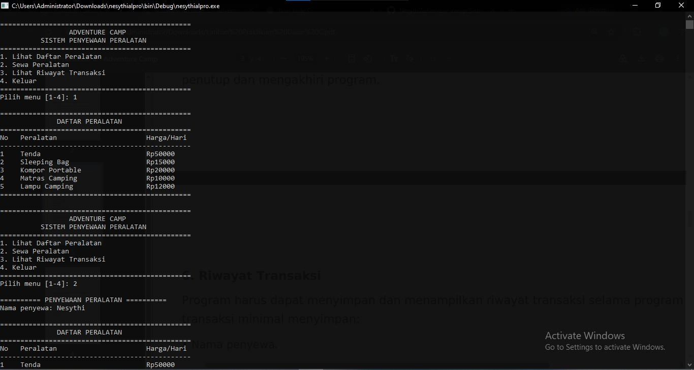
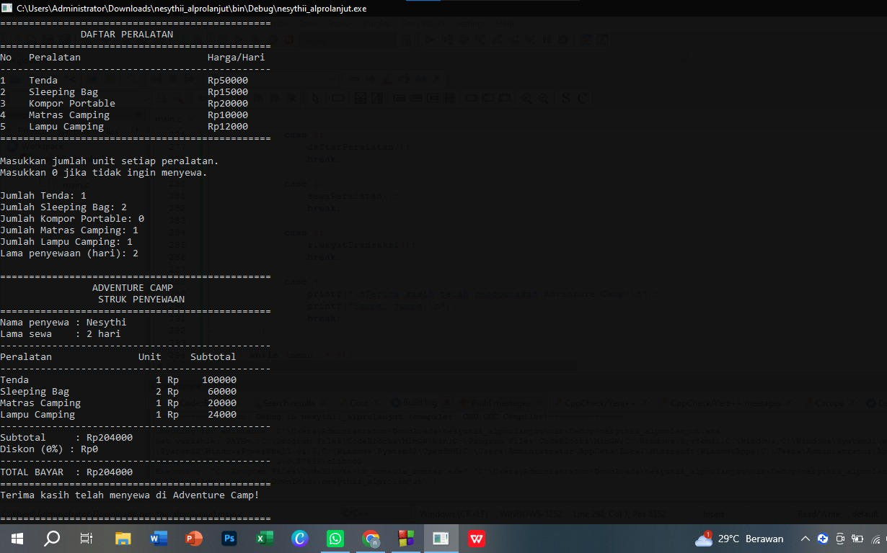
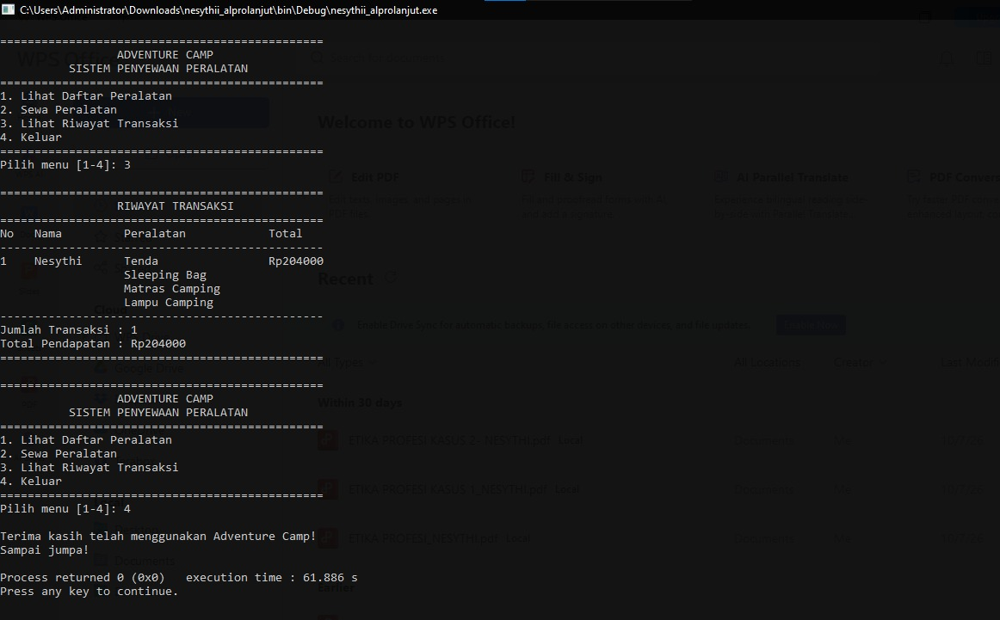

# Adventure Camp - Sistem Penyewaan Peralatan Camping

## Identitas Mahasiswa

- **Nama:** Nesythi Mus’idah
- **NIM:** C2583207033
- **Nama Proyek:** Adventure Camp
- **Mata Kuliah:** Algoritma dan Pemrograman Lanjutan

## Deskripsi Program

Adventure Camp merupakan aplikasi berbasis console yang dibuat menggunakan bahasa pemrograman C untuk membantu proses penyewaan peralatan camping.

Program ini dapat menampilkan daftar peralatan, memproses penyewaan beberapa jenis peralatan dalam satu transaksi, menghitung biaya sewa dan diskon secara otomatis, menampilkan struk pembayaran, serta mencatat riwayat transaksi selama program berjalan.

## Fitur Program

1. Menampilkan daftar peralatan dan harga sewa.
2. Melakukan penyewaan beberapa jenis peralatan dalam satu transaksi.
3. Menghitung subtotal berdasarkan harga, jumlah unit, dan lama penyewaan.
4. Memberikan diskon berdasarkan lama penyewaan.
5. Menampilkan struk penyewaan.
6. Menampilkan riwayat transaksi.
7. Menghitung jumlah transaksi dan total pendapatan.
8. Memvalidasi masukan pengguna.
9. Membatasi penyimpanan hingga 10 transaksi dalam satu sesi program.

## Daftar Peralatan dan Harga

| No. | Nama Peralatan | Harga Sewa per Hari |
|---|---|---:|
| 1 | Tenda Kapasitas 4 Orang | Rp50.000 |
| 2 | Sleeping Bag | Rp15.000 |
| 3 | Kompor Portable | Rp20.000 |
| 4 | Matras Camping | Rp10.000 |
| 5 | Lampu Camping | Rp12.000 |

## Ketentuan Diskon

| Lama Penyewaan | Diskon |
|---|---:|
| 1–2 hari | 0% |
| 3–4 hari | 10% |
| 5 hari atau lebih | 15% |

## Rumus Perhitungan

**Subtotal**

Subtotal = Harga Sewa × Jumlah Unit × Lama Penyewaan

**Diskon**

Diskon = Subtotal × Persentase Diskon / 100

**Total Pembayaran**

Total Bayar = Subtotal − Diskon

## Teknologi yang Digunakan

- Bahasa pemrograman C.
- `printf()` dan `scanf()` untuk input dan output.
- Percabangan `if-else` dan `switch-case`.
- Perulangan `for` dan `do-while`.
- Fungsi buatan sendiri.
- Array untuk data peralatan dan riwayat transaksi.
- Validasi input.

## Cara Menjalankan Program

1. Unduh atau clone repository ini.
2. Buka file `main.c` menggunakan Code::Blocks atau compiler C lainnya.
3. Kompilasi program.
4. Jalankan program.
5. Pilih menu sesuai kebutuhan.

Jika menggunakan Code::Blocks, pilih **Build → Build and Run** atau tekan **F9**.

## Screenshot Hasil Eksekusi

Tambahkan screenshot asli hasil program pada bagian berikut.

### 1. Foto 1

### 2. Foto 2

### 3. Foto 3

